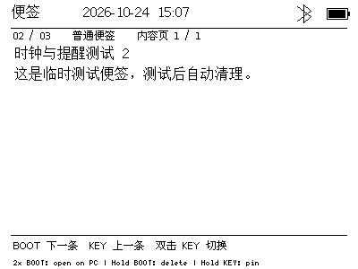
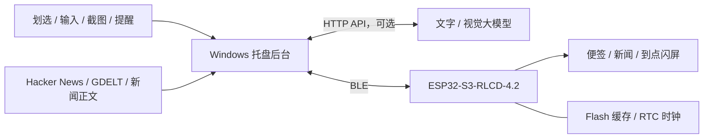
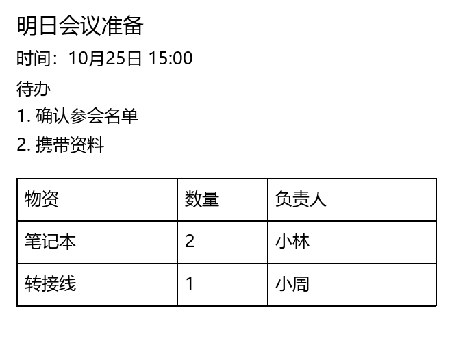
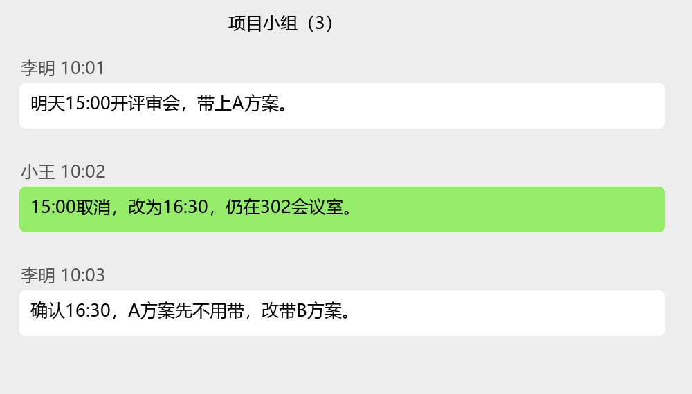

# 桌面小伴侣 · Desk Companion

[](https://github.com/fanzipei/desk-companion/actions/workflows/pc-tests.yml)
[Apache-2.0](LICENSE) · [使用指南](docs/usage.md) · [开发与刷写](docs/development.md) · [贡献指南](CONTRIBUTING.md)

把 PC 上的一段文字、截图里的事项或每天的新闻，送到桌边的一块小屏幕上。

本项目由 **微雪 Waveshare ESP32-S3-RLCD-4.2 开发板固件**和 **Windows 托盘后台程序**组成，通过 BLE 同步便签、新闻、显示设置、时间和提醒。PC 平时只保留托盘图标；划选发送不弹窗，需要输入、设置或确认提醒时才出现小窗口。

下面是设备程序导出的实际屏幕帧缓冲，内容为临时测试便签；它不是硬件外观照片：



## 目录

- [主要功能](#主要功能)
- [硬件准备](#硬件准备)
- [工作原理](#工作原理)
- [安装与首次运行](#安装与首次运行)
- [设置说明](#设置说明)
- [日常操作](#日常操作)
- [演示样例](#演示样例)
- [数据与隐私](#数据与隐私)
- [开发与测试](#开发与测试)
- [常见问题](#常见问题)
- [项目结构](#项目结构)
- [License](#license)

## 主要功能

| 功能 | 行为 | 大模型要求 |
| --- | --- | --- |
| 划选发送 | 选中文字，Ctrl+Alt+J 静默发送到设备 | 无 |
| 便签输入 | Ctrl+Alt+空格打开托盘附近的小输入框，Enter 发送并关闭 | 无；语音输入使用 Windows 自身能力 |
| 截图识别 | Ctrl+Alt+K 框选；纯文本完整转录，聊天等场景按上下文整理 | 支持图片输入的 API，须先验证 |
| 新闻阅读 | 混合 Hacker News 与 GDELT，标记来源，默认保留 20 条 | 标题模式无需大模型 |
| 中文简讯 | 获取正文、必要时检索相关报道，生成 60–120 汉字中文简讯 | 文字 API |
| 提醒 | AI 提议时间、用户确认；同一分钟自动合并，设备到点定位便签并闪屏 | AI 解析需要文字 API，手动填写时间无需大模型 |
| 设备操作 | BOOT / KEY 翻页、置顶、删除，双击在 PC 打开 | 无 |
| 显示与时间 | 主题、字号、行距、底部提示可调；显示日期时间、蓝牙与电池图标 | 无 |

便签默认最多 20 条，可设为 1–20 条；新闻默认共 20 条，可设为 1–50 条。每条便签最多 **3072 UTF-8 字节**，约 1024 个常见汉字，混合文字按实际字节数计算。内容较长时在屏幕上分页，不静默截断。

## 硬件准备

### 必需硬件

| 硬件 | 数量 | 要求及用途 |
| --- | --- | --- |
| **微雪 Waveshare ESP32-S3-RLCD-4.2 开发板** | 1 | 本项目当前适配和实机验证的目标板，包含 ESP32-S3 主控、4.2 英寸 RLCD、BOOT / KEY / PWR 按键等 |
| **USB-C 数据线** | 1 | 连接开发板与 PC，用于供电、首次刷写和串口日志；需要支持数据传输 |
| **Windows PC** | 1 | Windows 10 / 11，运行托盘后台；联网时负责抓取新闻、调用模型 |
| **支持 BLE 的蓝牙适配器** | 1 | PC 内置蓝牙可用；没有内置蓝牙时使用支持 BLE 的 USB 适配器 |

请核对完整型号 **ESP32-S3-RLCD-4.2**。固件的屏幕驱动、引脚和电源按键逻辑均按这块板配置；其他尺寸屏幕或普通 ESP32-S3 开发板需要单独适配。

### 这块板上已有的资源

- ESP32-S3-WROOM-1-N16R8，**16 MB Flash / 8 MB PSRAM**。
- 4.2 英寸全反射式 **RLCD**，原生分辨率 **300 × 400**，本项目按 **400 × 300 横向**显示。
- Bluetooth 5 LE、2.4 GHz Wi-Fi；本项目当前使用 BLE 与 PC 通信，新闻通过 PC 的网络获取。
- BOOT、KEY、PWR 三枚实体按键，板载 PCF85063 系列 RTC 和电池管理电路。

屏幕使用环境光反射成像，没有背光。当前项目使用单色文字界面。板卡规格、接口和结构以[微雪官方文档](https://docs.waveshare.com/ESP32-S3-RLCD-4.2)为准。

### 可选硬件与供电

| 可选硬件 | 何时需要 |
| --- | --- |
| 与板卡电池座匹配的 18650 电池 | 希望拔掉 USB 后仍能阅读缓存、走时和触发已同步的提醒 |
| 官方规格匹配的可充电 RTC 备份电池 | 希望所有主电源断开后 RTC 仍保时；按官方要求选择 PH1.0 接口的可充电 RTC 电池 |
| PC 麦克风 | 使用输入框里的 Windows 语音输入功能；这条输入链路使用 PC 麦克风 |

入门时使用 USB 供电即可。**蓝牙断开与设备断电是两种情况**：设备持续供电时可独立触发已保存的提醒；完全断电期间无法闪屏，重新供电并恢复有效时钟后才会检查到期日程。TF 卡、温湿度传感器和板载音频目前不是这两个核心功能的前提。

## 工作原理



PC 负责新闻抓取、图片理解、AI 时间解析、持久化发送队列和打开网页。设备负责显示、按键、Flash 缓存和提醒触发。

首次连接时 PC 同步时间，此后连接期间约每 **4 小时**再校时一次。设备使用板载 RTC 保时，当前按**北京时间 UTC+8**显示日期和时间。新闻的两个来源各每 **10 分钟**刷新，正常调度错开约 **5 分钟**；GDELT 首次抓取通常在程序启动约 5 分钟后进行。

## 安装与首次运行

当前以**源码**发布，需要安装 PC Python 环境；首次给开发板刷写还需要 ESP-IDF。仓库不自带预编译固件或一键安装包。如果设备已经运行本项目固件，可以直接安装 PC 端并连接。

### 1. 获取源码

安装 Git，在普通 PowerShell 中执行：

```powershell
git clone https://github.com/fanzipei/desk-companion.git
cd desk-companion
```

后面的相对路径命令均以这个仓库根目录为工作目录。固件 SDK 建议放在简短、无空格的英文路径；仓库脚本把构建输出放在系统临时目录，兼容本项目的中文工作目录。

### 2. 安装 PC 端

需要 Python **3.12–3.14**，包含 Tk。先确认当前普通 PowerShell 中的 Python：

```powershell
python --version
```

安装依赖可以使用脚本：

```powershell
.\setup-pc.ps1
```

也可以手动执行同等步骤，无需激活虚拟环境：

```powershell
python -m venv .venv
.\.venv\Scripts\python.exe -m pip install -r requirements.txt
```

主要依赖为 `bleak`、`pystray`、`Pillow`；PC 程序使用 Windows 原生快捷键、剪贴板与 DPAPI。PC Python 环境和下一节的 ESP-IDF Python 环境各自独立。

### 3. 安装 ESP-IDF 并准备串口

首次刷写使用 **ESP-IDF v5.3.2**：

1. 按[乐鑫 Windows 安装指南](https://docs.espressif.com/projects/esp-idf/en/v5.3.2/esp32s3/get-started/windows-setup.html)安装对应版本的 ESP-IDF 工具链。
2. 打开安装器提供的 **ESP-IDF PowerShell**，运行 `idf.py --version`，确认是 v5.3.2。
3. 用 USB-C 数据线连接开发板，在设备管理器中确认实际 COM 口。
4. 在这个 ESP-IDF PowerShell 中进入本仓库目录。

以下用 **COM6** 举例，务必换成自己设备的串口。刷写前先退出小伴侣托盘程序及占用该串口的其他工具。

### 4. 先备份，再编译和刷写

在仓库根目录执行：

```powershell
.\tools\backup-device.ps1 -Port COM6
.\tools\build-device.ps1
.\tools\flash-companion.ps1 -Port COM6
```

- 第一步读取完整 16 MB Flash，保存备份和 SHA256 清单；已有有效备份只校验，不覆盖。
- 第二步生成 `device/dist/` 下的 bootloader、分区表和应用固件。
- 第三步更新程序，保留本项目的 NVS 和专用数据存储区；刷写前会校验备份及应用大小。

脚本优先使用已激活 ESP-IDF 环境里的 `IDF_PATH`、`IDF_TOOLS_PATH`、`IDF_PYTHON_ENV_PATH`。如果 SDK 使用本项目的备用目录布局，可指定路径：

```powershell
.\tools\build-device.ps1 -EspRoot 'D:\esp'
```

备份和刷写脚本还支持 `-Python '实际路径\python.exe'`，用于指定装有 esptool 的 SDK Python。详细目录约定、手动构建方式和回滚范围见[开发与刷写](docs/development.md)。

`-RestoreOriginal` 是恢复备份的操作，会移除备份之后的小伴侣数据，**不是普通更新参数**。完整 Flash 备份可能包含凭证，应只留在本机。

### 5. 启动并连接 BLE

回到普通 PowerShell，执行：

```powershell
.\启动小伴侣.bat
```

也可以双击 `启动小伴侣.bat`。程序正常运行时只显示系统托盘图标，没有主窗口；图标可能在托盘的折叠区域内。

1. 打开 PC 蓝牙，确保开发板已开机。
2. 程序自动发现 BLE 名称为 `DeskCompanion` 的设备并连接。
3. 有多个设备时，右键托盘 → **设置 → 常规**，填写目标蓝牙地址；默认留空自动发现。
4. 连接成功后，程序同步时钟、便签、新闻和设置。先用下面的“第一条便签”样例验证链路。

### 6. 按需开启大模型功能

基础便签和新闻标题模式不需要 API。需要截图理解、中文新闻简讯或 AI 提议提醒时间时，再按[大模型设置](#大模型设置)配置。

## 设置说明

右键托盘图标 → **设置…**。保存后，PC 配置在本机持久保存；显示偏好、便签上限等会通过 BLE 同步到设备。

### 常规与显示

| 设置项 | 范围或默认行为 |
| --- | --- |
| 划选、输入、截图、提醒快捷键 | 可自定义；四组快捷键须互不冲突 |
| 便签上限 | 1–20，默认 20；不能降低到已有便签或待发送数量以下 |
| 蓝牙地址 | 默认空，自动发现；可指定目标设备 |
| 显示风格 | 白底黑字 / 黑底白字 |
| 正文字体 | 12 / 16 / 24 / 32 像素；24 / 32 为位图字形放大 |
| 额外行间距 | 0–16 像素，默认 7 |
| 底部操作提示 | 可隐藏，隐藏后增加阅读空间，按键行为保留 |

屏幕顶部显示当前模式、日期时间、蓝牙图标和电池图标。蓝牙断开时图标有斜线；电量通过电池填充表示，是电压采样估算，不显示百分比数字。

### 新闻与代理设置

新闻总上限默认 20，可设为 1–50。已置顶新闻优先保留；翻页、阅读、在 PC 打开都不会删除新闻。主动删除的新闻会记录删除标识，避免刷新后立即重新出现。

GDELT 查询默认 `sourcelang:english`，例如可改为：

```text
sourcelang:chinese
("artificial intelligence" OR technology)
```

新闻代理在 **设置 → 新闻** 中配置：

| 方式 | 行为 |
| --- | --- |
| 自动（系统 / 直连） | 优先尝试系统代理，失败后尝试直连；新闻源可复用上次成功方式 |
| 自定义代理 | 使用填写的 HTTP/HTTPS 代理；失败时不主动回退到直连 |
| 不使用代理 | 直连，关闭这条新闻请求链路的系统代理 |

自定义地址示例：

```text
http://127.0.0.1:7897
```

填写代理软件实际开放的 **HTTP 或混合端口**，包含主机和端口；当前不支持 SOCKS、带账号密码或查询参数的代理地址。这里的设置同时用于 **HN、GDELT、新闻正文和相关报道检索**，不改变大模型 API 的现有连接方式。修改代理并保存后会重新调度新闻更新。

### 大模型设置

在 **设置 → 大模型** 填写：

| 字段 | 填写示例 |
| --- | --- |
| API 基础地址 | `https://api.example.com/v1`，需替换为服务商实际地址 |
| 模型名称 | 服务商提供的文字或视觉模型名称 |
| API 密钥 | 自己的密钥，输入框隐藏显示；留空保存会保持已有密钥 |

采用 OpenAI 兼容的 **Chat Completions** 接口格式，也接受完整 `/chat/completions` 地址；远程使用 HTTPS，本地模型可用 `http://localhost`。

- **中文新闻简讯**：勾选启用后，将已获取的新闻资料整理为 60–120 个汉字的中文简讯，校验合格后发送。只输出新闻事实，不把“正文抓取失败”等过程说明写进简讯。生成失败时保留缓存并稍后重试。
- **截图识别**：点击“验证 API 与图片能力”。程序先测文字响应，再发送一张合成数字图进行实际图片识别；通过后，在“工具”中勾选启用截图识别并保存。
- **提醒解析**：验证过的文字 API 可为最后一条已送达便签提议时间；最终必须由用户确认，也可以手动填写时间。

API 地址、模型或密钥改变后，截图能力需要重新验证。仅接口地址能访问、或模型名称看起来支持图片，不算验证通过。

## 日常操作

### PC 快捷键

| 操作 | 默认快捷键 |
| --- | --- |
| 静默发送当前选中文字 | **Ctrl+Alt+J** |
| 打开托盘附近的小输入框 | **Ctrl+Alt+空格** |
| 框选截图并识别成便签 | **Ctrl+Alt+K** |
| 为最后一条已送达便签设置提醒 | **Ctrl+Alt+L** |
| 输入框发送并收起 | Enter |
| 输入框内换行 | Shift+Enter |
| 取消截图 / 关闭输入框或便签预览 | Esc |

中文输入法正在选词时，Enter 先确认候选词。输入框中的“语音”使用 Windows 语音输入，需要 PC 麦克风和系统相应能力。

### 开发板按键

| 按键 | 便签模式 | 新闻模式 |
| --- | --- | --- |
| 短按 BOOT | 下一条；长内容先翻下一内容页 | 下一条；长内容先翻下一内容页 |
| 短按 KEY | 上一条 / 上一内容页 | 上一条 / 上一内容页 |
| 双击 BOOT | 在 PC 显示当前便签，便于复制 | 在 PC 默认浏览器打开原新闻网页 |
| 双击 KEY | 切换到新闻模式 | 切换到便签模式 |
| 长按 BOOT | 删除当前便签 | 删除当前新闻 |
| 长按 KEY | 置顶 / 取消置顶 | 置顶 / 取消置顶 |

双击判定窗口约 350 ms，长按约 1 秒。单击会稍等双击判定，不会因双击而额外翻页。

**PWR** 由硬件电源电路处理：长按关机、短按开机。模式切换使用双击 KEY。提醒画面出现后，按 BOOT 或 KEY 结束提醒，便签继续保留。

便签满额时替换最早的未置顶便签；全部置顶时保留待发送队列，待取消置顶或删除后继续同步。新闻刷新也优先保留已置顶条目。

## 演示样例

以下文字和聊天图均为合成演示内容。便签界面的图片是设备导出的真实帧缓冲，没有包含私人便签、真实聊天或 API 密钥。

### 样例一：发送第一条便签

在记事本中输入并选中：

```text
明天下午3点，在302会议室评审。
准备B方案和会议资料。
```

按 **Ctrl+Alt+J**。PC 不会弹出输入窗口或通知，设备收到后显示这条便签。用 BOOT / KEY 查看；双击 BOOT，可在 PC 托盘附近打开该条便签进行复制。

也可以按 **Ctrl+Alt+空格**，在小输入框中输入同样内容，按 Enter 发送并收起。

### 样例二：纯文本截图完整保留

假设截图包含：

```text
第一条：本次仅调整截图识别，不修改设备设置。
第二条：编号 A-017，数量 12，预算 85.50 元。
第三条：This text must remain in English.
备注：此段也要完整保留，不得省略。
```

配置并验证图片 API 后，按 **Ctrl+Alt+K** 框选这块区域。纯文本场景会要求完整转录可辨认的原文，保留语言、数字、标点和换行，不将上面四行压缩成一句概述。识别清晰度和模型能力仍会影响结果。

### 样例三：保留分项和简单表格

合成输入图：



保存后的便签格式示例：

```text
明日会议准备
时间：10月25日 15:00

待办
1. 确认参会名单
2. 携带资料

物资 | 数量 | 负责人
笔记本 | 2 | 小林
转接线 | 1 | 小周
```

表格以纯文本分列保留表头和每行对应关系，不依赖 Markdown 渲染；过宽时可逐行整理成“字段：值”，保留记录归属。示例日期只用于格式演示。

### 样例四：理解微信聊天中的改期

合成聊天输入图：



按 **Ctrl+Alt+K** 框选后，模型应结合上下文理解最终安排，而不是把已取消的时间当成新的待办。要点示例：

```text
最终安排：明天16:30开评审会
地点：302会议室
携带材料：B方案；不带A方案
原15:00安排已取消
```

聊天场景可去除无关界面和寒暄，保留人物归属、否定、取消、改期及确认关系。示例展示预期理解的要点，具体措辞由所配置模型决定。

### 样例五：设置并合并提醒

1. 先发送“明天下午3点在302会议室评审，准备B方案”，等待它出现在设备上。
2. 按 **Ctrl+Alt+L**，PC 打开提醒确认框；检查 AI 提议的日期和时间，也可以手动修改，格式为 `年-月-日 时:分`。
3. 点击“确认提醒”。没有明确未来时间时，需要自行填写；取消不会建立提醒。
4. 再发送另一条便签“明天下午3点提交测试报告”，送达后同样设置提醒，选择与上一条相同的分钟。
5. 确认框会提示已有便签，该时间的两条便签自动合为一组。

到点后，设备自动切换到便签模式，定位组内便签，反色闪烁约 **7 秒**，然后保持提醒画面；合并组约每 **5 秒**轮换一条。一般提醒显示约 1 分钟，大组至少轮换一遍。按 BOOT 或 KEY 关闭提醒。

设备保存最早的 **64 组**待提醒日程，持续供电且时钟有效时，断开 BLE 或关闭 PC 后也可触发。超过容量、或便签已不在设备中的提醒由运行中的 PC 处理。PC 在线时还会显示合并便签和系统通知。

### 样例六：阅读新闻并在 PC 打开

1. 启动 PC 后台并连接设备，等待新闻更新；首次 GDELT 通常比 HN 晚约 5 分钟。
2. 双击 KEY 切到新闻模式，BOOT 下一条、KEY 上一条。
3. 序号旁的 `[HN]` / `[GDELT]` 区分来源；GDELT 条目还显示媒体域名。
4. 双击 BOOT，在 PC 默认浏览器打开当前新闻；长按 KEY 可置顶，长按 BOOT 可删除。

启用中文简讯后，正文显示 60–120 汉字的整理结果。以下只是虚构的简讯格式示意，不是实时新闻：

```text
[HN]
研究团队公布新的机器人控制方法，通过模拟训练提升复杂环境下的操作能力，
并在多项实验中展示稳定表现。相关代码和评估结果已经公开，后续仍需在真实
应用场景中检验其适用范围与长期可靠性。
```

阅读或打开网页都不会自动删除新闻。新闻源暂时失败、GDELT 限流或模型返回不合格时，程序保留已有缓存。

## 数据与隐私

| 本地位置 | 保存内容 |
| --- | --- |
| `data/state.json` | 配置、已确认便签缓存、待发送队列、新闻缓存等 |
| `data/reminders.json` | 已确认的提醒及完成状态 |
| `data/news-api-key.dpapi` | Windows DPAPI 加密的 API 密钥 |
| `data/api-capabilities.json` | 与当前 API 配置匹配的文字 / 图片验证结果 |
| `logs/` | 本机运行日志、显式验收生成的结果与帧缓冲 |
| `backups/` | Flash 备份与校验清单 |

`data/`、`logs/`、`backups/`、虚拟环境和构建产物由 Git 忽略。API 密钥不写入设备或普通配置 JSON；DPAPI 密钥文件与本机 Windows 用户关联，换电脑应重新填写密钥。

普通划选和手动输入通过本机与 BLE 发送。截图功能只上传所框选区域到你配置的模型 API；整桌面截图只暂存内存，不写文件、不上传。AI 提醒解析会发送对应便签正文，中文新闻简讯会发送已获取的新闻资料。Windows 语音输入由系统自身处理，与本项目配置的图片 API 独立。

请勿把私人截图、完整日志、个人配置、API 密钥或 Flash 镜像放入 Issue / PR。仓库中的演示图片只使用合成内容或临时测试便签。

## 开发与测试

PC 单元测试在 Windows 运行：

```powershell
.\.venv\Scripts\python.exe -m unittest discover -s tests -p 'test_*.py' -v
```

GitHub Actions 在 Python **3.12 / 3.14** 上运行同一套 PC 测试。单元测试不连接实体板卡或外部新闻 / 模型服务，代理链路用本机模拟服务器验收。

固件构建使用：

```powershell
.\tools\build-device.ps1
```

`tests/*_device.py` 等是需手动运行的实机验收，会实际与设备通信。先退出托盘后台、核对串口及蓝牙目标，并阅读[实机验收说明](docs/development.md#实机验收)。可通过环境变量指定目标：

```powershell
$env:DESK_COMPANION_ADDRESS = 'AA:BB:CC:DD:EE:FF'
.\.venv\Scripts\python.exe -m tests.display_device
```

开发流程、存储布局、备份和回滚说明见 [docs/development.md](docs/development.md)。欢迎按[贡献指南](CONTRIBUTING.md)提交改进。

## 常见问题

| 问题 | 检查方式 |
| --- | --- |
| 启动后没有主窗口 | 正常行为；检查系统托盘及折叠图标区域，右键图标打开设置 |
| 连接不到 DeskCompanion | 确认已刷入本项目固件、设备开机、PC 蓝牙可用且距离较近；多个设备时指定地址 |
| USB 接上但没有 COM 口 | 换用支持数据传输的线，检查设备管理器，并按微雪官方说明排查驱动或下载模式 |
| Ctrl+Alt+J 没反应 | 确认已选中文字并松开快捷键，检查是否冲突；从普通权限窗口重试，或用小输入框粘贴。错误见托盘提示及日志 |
| 取词失败后后台是否退出 | 取词放在独立进程中，超时或底层错误会使本次取词失败，后台继续运行；剪贴板常见格式尽力恢复，保留用户后来复制的新内容 |
| Ctrl+Alt+K 没启用 | 在“大模型”验证文字与图片能力，再在“工具”启用并保存；更换 API 配置后需重新验证 |
| 截图内容太长 | 缩小选区或分几条截图；超出 3072 UTF-8 字节会提示，不静默删字 |
| 开始时只看到 HN | GDELT 首次正常调度约晚 5 分钟；限流时会按等待时间延后，不清空已有内容 |
| 中文简讯迟迟不更新 | 检查模型配置、文字能力及新闻代理；长度不合格或 API 失败会保留缓存后重试 |
| PWR 短按不能切换模式 | PWR 属于硬件电源逻辑；本项目用双击 KEY 切换 |
| 断开 PC 后提醒没响 | 检查设备是否持续供电、时钟是否有效，以及提醒是否已通过 BLE 同步；完全断电期间无法闪屏 |
| 想停止后台 | 右键托盘 → 退出。设备已有便签和新闻缓存仍保留 |

## 项目结构

```text
pc/                       Windows 托盘后台
  app.py                  托盘、输入框、设置与事件处理
  bridge.py               BLE、两源新闻与简讯工作线程
  core.py                 本地缓存、队列与新闻模型
  ai.py                   文字 / 图片调用及能力验证
  selection.py            独立进程取词与剪贴板处理
  news_network.py         新闻代理策略
  reminders.py            提醒解析、确认、合并与持久化
  protocol.py             BLE 请求、响应与分块同步
device/
  main/                   显示、按键、RTC、电池和提醒逻辑
  components/             U8g2、字体与 ST7305 驱动
  sdkconfig               ESP-IDF 配置
  partitions.csv          Flash 分区布局
tools/                    构建、完整备份与刷写脚本
tests/                    PC 单元测试及显式实机验收
docs/                     使用、开发、许可与演示图片
LICENSES/                 第三方许可及字体例外
.github/workflows/        Windows CI
LICENSE                   Apache-2.0 正式文本
NOTICE                    原创项目版权与归属提示
THIRD_PARTY_NOTICES.md     第三方来源及许可说明
```

## License

**项目原创代码采用 Apache-2.0**，见 [LICENSE](LICENSE) 和 [NOTICE](NOTICE)。允许商用及闭源衍生，包含明确的贡献相关专利许可；分发时须保留许可证、适用版权和声明，并标注修改。

第三方组件继续遵守原许可：U8g2 为 BSD-2-Clause，微雪 ST7305 驱动为 Apache-2.0，文泉驿字体保留 GPLv2 与字体嵌入例外，其他依赖也有各自条款。**根目录 Apache-2.0 不会将这些第三方代码或字体重新授权，也不表示完整固件的所有部分都只有 Apache 条款。** 分发组合固件或打包依赖时须结合相应授权处理。

来源及完整声明见 [THIRD_PARTY_NOTICES.md](THIRD_PARTY_NOTICES.md)，许可比较见 [docs/licensing.md](docs/licensing.md)。本仓库不对微雪硬件设计、商标、第三方新闻内容或用户截图授予额外权利。
